<h1><strong>geneviewer</strong> - Gene Cluster Visualizations in R</h1>

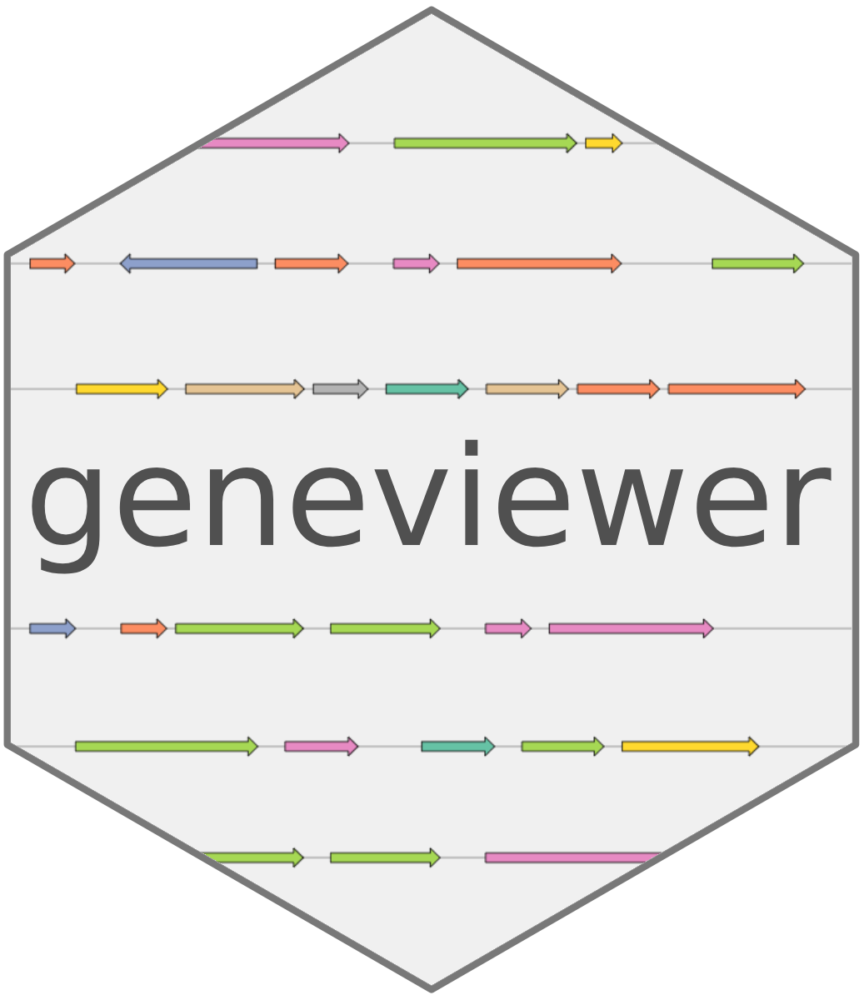

<!-- badges: start -->

[](https://github.com/nvelden/geneviewer/actions/workflows/R-CMD-check.yaml) [](https://CRAN.R-project.org/package=geneviewer) [](https://cran.r-project.org/package=geneviewer) 

<!-- badges: end -->

**geneviewer** is an R package for plotting gene clusters and transcripts. It imports data from GenBank, FASTA, and GFF files, performs BlastP and MUMmer alignments, and displays results on gene arrow maps. The package offers extensive customization options, including legends, labels, annotations, scales, colors, tooltips, and more. To explore all features visit the [package website](https://nvelden.github.io/geneviewer/articles/geneviewer.html).

<br clear="right">

## Interactive Shiny Dashboard

Try the **[Gene Cluster Dashboard](https://nvelden.github.io/geneviewer-shinylive/)** - a web interface that provides point-and-click access to geneviewer's visualization features. *(Allow 1-2 minutes for loading)*

**[Dashboard Repository](https://github.com/nvelden/geneviewer-shinylive)**


## Installation

You can install the released version of **geneviewer** from CRAN with:

```r
install.packages("geneviewer")
```

And the development version from GitHub with: 

``` r
# install.packages("devtools")
devtools::install_github("nvelden/geneviewer")
```

## Usage

The below example demonstrates using **geneviewer** to plot a gene cluster on a genomic sequence, using the start and end positions of each gene. The genes are grouped by class and labels are added using the `GC_labels` function.

``` r
library(geneviewer)

# Data
gene_cluster <- data.frame(
  name = c("ophB1", "ophC", "ophA", "ophD", "ophB2", "ophP", "ophE"),
  start = c(2522, 5286, 9536, 12616, 13183, 19346, 20170),
  end = c(4276, 4718, 10904, 11859, 15046, 16016, 21484),
  class = c("Monooxygenase", "NTF2-like", "Methyltransferase", 
  "O-acyltransferase", "Monooxygenase", "Prolyloligopeptidase", 
  "F-box/RNHI-like")
)

# Chart
GC_chart(gene_cluster, group = "class", height = "100px") %>%
  GC_labels("name")
```

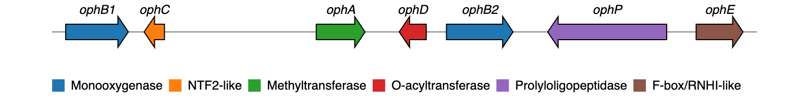

## Examples

For additional examples and the corresponding code to create the plots, please visit the [Examples](https://nvelden.github.io/geneviewer/articles/Examples.html) section.

> **Note:** Most of these examples use themes (`GC_theme()`), patterns (`GC_pattern()`) or other options that are only available in the development version of geneviewer. Install it with `devtools::install_github("nvelden/geneviewer")`.

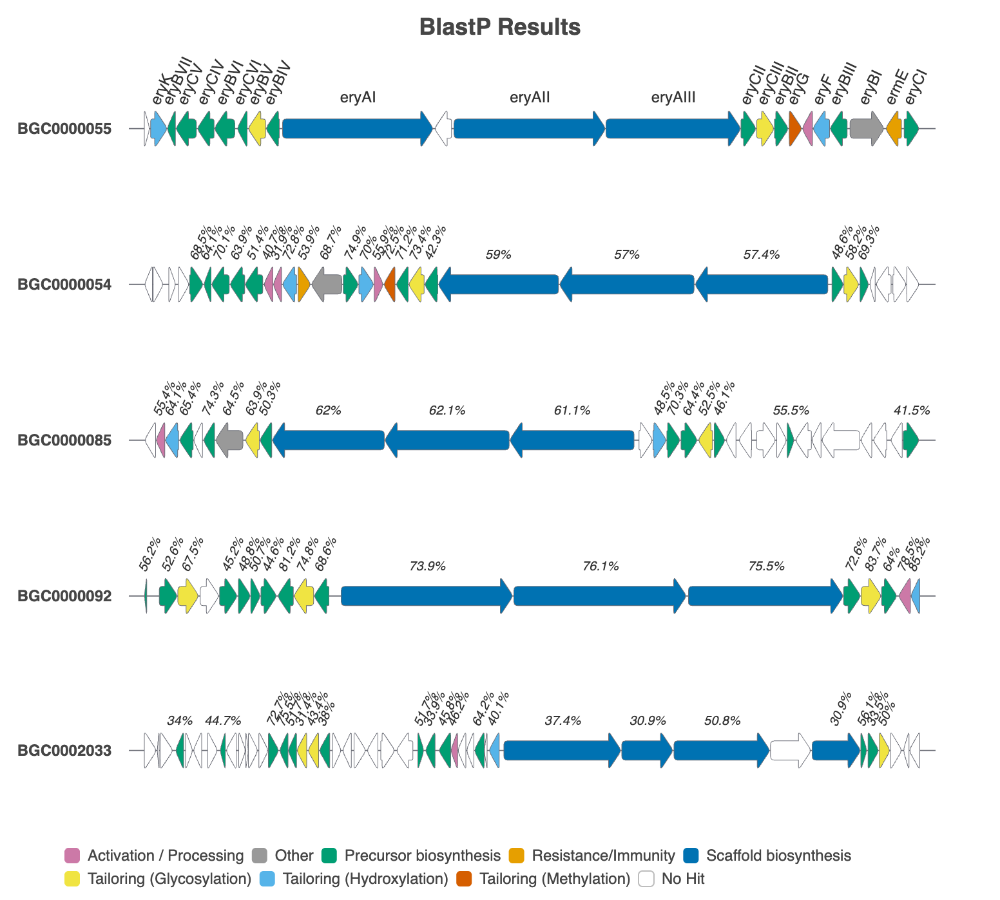

<hr>

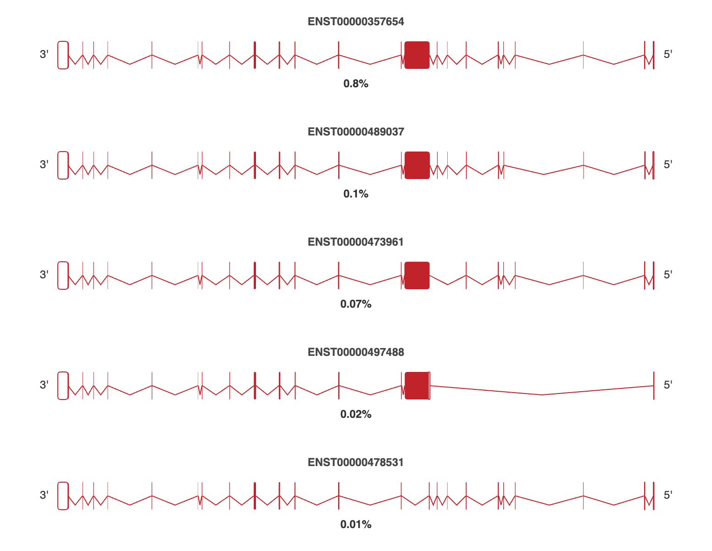

<hr>

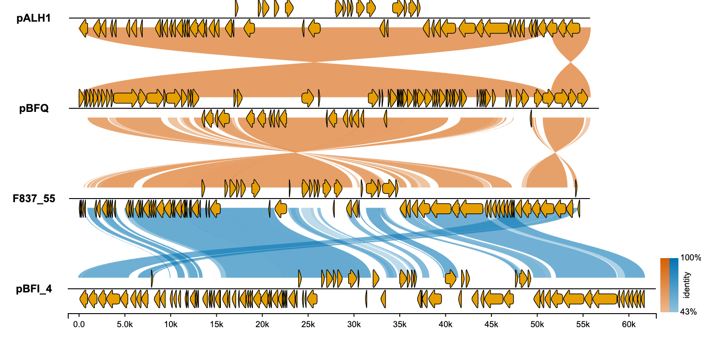

<hr>

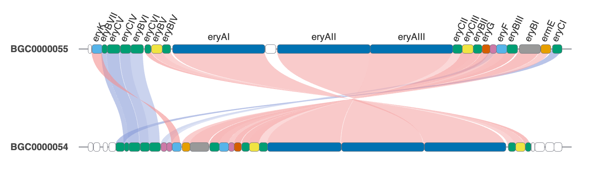

<hr>

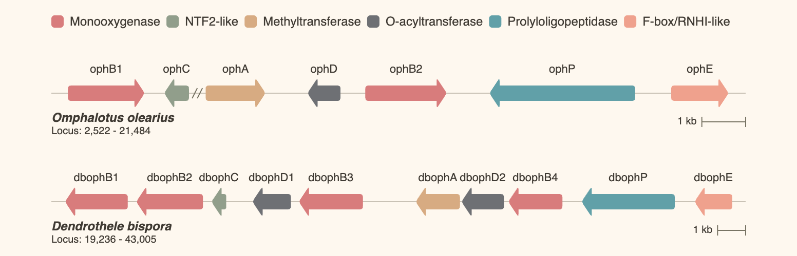

<hr>

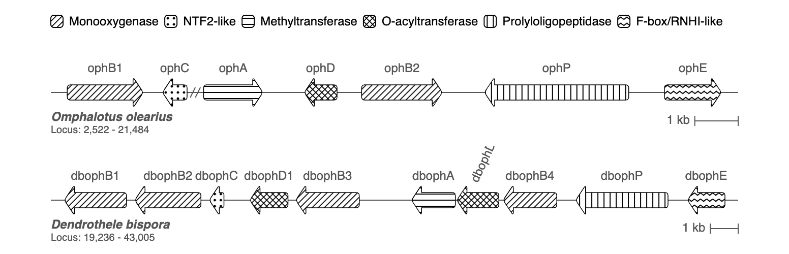

<hr>

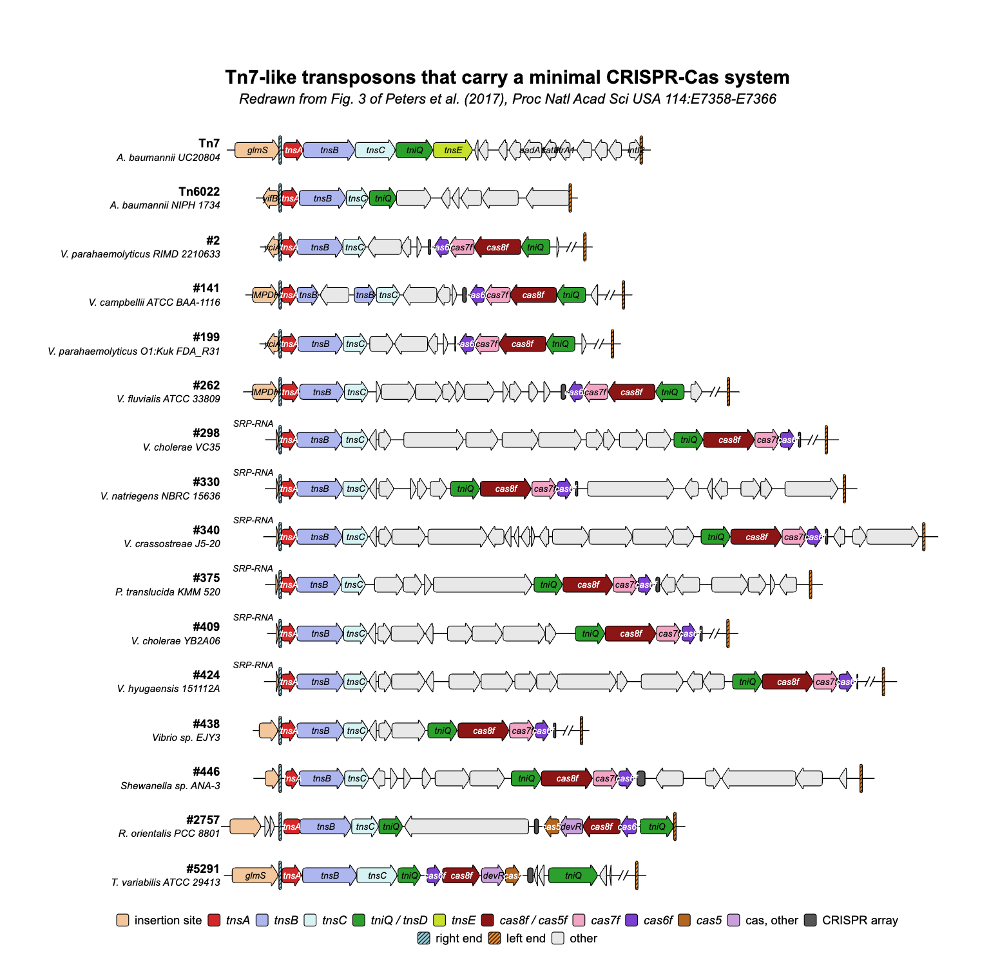

<hr>

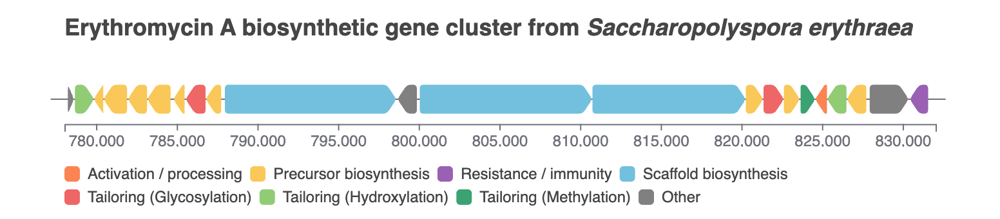

<hr>

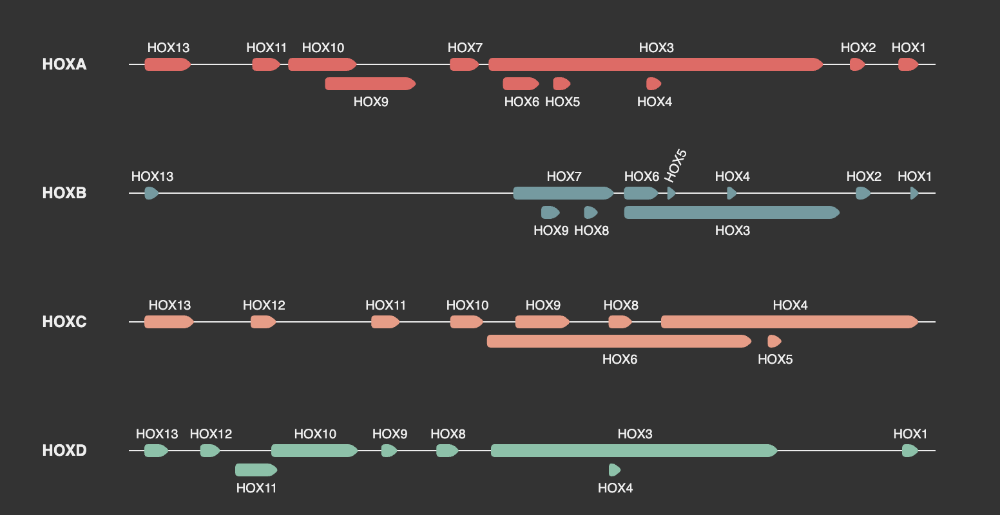

## Issues

If you encounter any issues or have feature requests, please open an [Issue](https://github.com/nvelden/geneviewer/issues).
